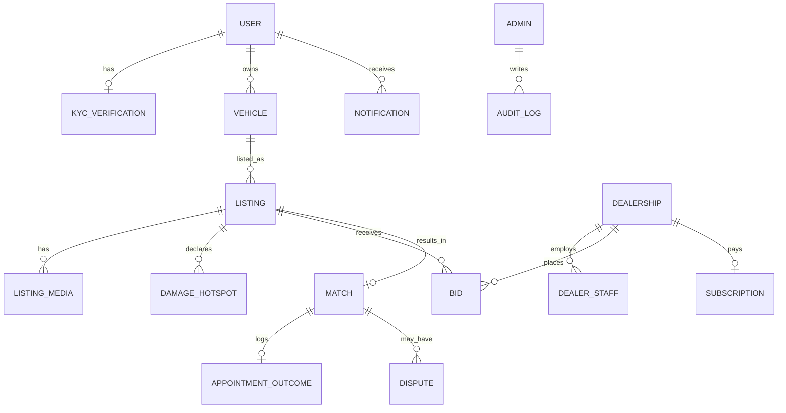

# 00 — Requirements, Workload Model & Hard Problems

Every scenario in this pack is scored against this document. Sources: SRS v1.0 §2–§7, `context/project-overview.md`, `context/architecture.md`.

---

## 1. Non-functional requirements (verbatim intent from SRS §5)

| ID | Category | Requirement | Architectural consequence |
|---|---|---|---|
| NFR-01 | Performance | Page load < 2 s p95; API < 500 ms p95 | DB and API in the same region; CDN for media; indexed feed queries |
| NFR-02 | Performance | **Bid submission < 200 ms** | Short transaction, no cold starts on the bid path, API close to the DB |
| NFR-03 | Scalability | **5,000 concurrent users, 1,000 open auctions**, documented horizontal path | Stateless API, shared session/cache, realtime fan-out layer |
| NFR-04 | Availability | 99.9% uptime (~43 min/month downtime); bid intake + auction close are critical | No single point of failure on critical paths, or a fast documented recovery |
| NFR-05 | Security | TLS 1.3; AES-256 at rest (DB + S3); bcrypt/argon2 | Managed encrypted storage; never hand-roll crypto |
| NFR-06 | Security | **MFA mandatory for ADMIN and DEALER_ADMIN** | Auth layer must support TOTP/WebAuthn and enforce it per role |
| NFR-07 | Security | Rate limiting on auth & bids; OWASP Top 10 | Redis/edge rate limiter; WAF optional |
| NFR-08 | Privacy | PIPEDA + Law 25; consent; access/deletion ≤ 30 days | Consent records, data-export & erasure jobs |
| NFR-09 | Residency | Media in ca-central-1; encrypted DB backups in Canadian region | **DB host location matters**, see §5 |
| NFR-10 | Reliability | Backups every 6 h; **RPO 1 h; RTO 4 h** | WAL/PITR, or backups more often than every 6 h. 6-hourly dumps alone **do not** meet RPO 1 h |
| NFR-11 | Auditability | Immutable audit trail, **7 years** | Append-only table + cold archive (S3 Object Lock / Glacier) |
| NFR-12 | Usability | WCAG 2.1 AA | Frontend concern |
| NFR-13 | Localization | EN/FR, CAD, km | Bilingual email/SMS templates server-side |
| NFR-14 | Integrity | Integer cents only | `BIGINT` cents columns; no `FLOAT`/`DECIMAL` arithmetic in app code |
| NFR-15 | Concurrency | Optimistic locking on bid revision; idempotent, race-safe auction close | Transactions + version column / `SELECT … FOR UPDATE`; idempotency keys |
| NFR-16 | Maintainability | PR review, **70% coverage on auction engine + billing**, CI gate | The auction engine must be unit-testable in isolation (not buried in UI handlers or SQL-only logic) |

> [!WARNING]
> **NFR-10 contradiction in the SRS.** "Backups every 6 hours" alone cannot guarantee "RPO 1 hour". Any option chosen needs **continuous WAL archiving / PITR** (managed Postgres, Supabase Pro + PITR add-on, RDS) or ≤ hourly incremental backups.

---

## 2. Workload model (derived estimate)

Assumptions are stated so the team can challenge them.

| Quantity | Assumption | Estimate |
|---|---|---|
| Open auctions at peak | NFR-03 | 1,000 |
| Bids per auction per 24 h | Regional dealers, sealed, revisable | 15–40 (avg ~25) |
| Bids per day | 1,000 × 25 | **~25,000/day ≈ 0.3 bids/s average** |
| Peak bid rate | 10× burst in final 15 min of popular auctions | **~5–20 bids/s** |
| Concurrent connected users | NFR-03 | 5,000 (mostly dealers watching the feed) |
| Realtime connections | ~1 per open dealer/seller tab | **~3,000–5,000 SSE/WebSocket** |
| Feed reads | Dealers refresh/filter often | ~50–200 req/s peak, cache-friendly |
| New listings per day | Growth phase | 100–500 |
| Photos per listing | 8–30, ~400 KB WebP after compression | ~8 MB/listing |
| Media growth | 300 listings/day × 8 MB | **~2.4 GB/day ≈ 0.9 TB/year** (S3 + lifecycle) |
| DB size year 1 | Rows are small; media is off-DB | < 20 GB |

**Conclusion:** this is **not** a high-throughput system. A single well-built API instance with Postgres can handle the write load many times over. The engineering difficulty is **correctness and reliability**, not raw scale.

---

## 3. Domain model (from SRS §7.2 ERD, simplified)

Joins appear in almost every screen: dealer feed = listings ⨝ vehicles ⨝ media ⨝ distance ⨝ my-bid, and the seller unsealed view = bids ⨝ dealerships ⨝ distance ⨝ licence badge. **This strongly favours SQL.**

---

## 4. The hard problems (scoring axes)

| # | Problem | What "correct" looks like |
|---|---|---|
| H1 | **Sealed-bid secrecy** | Bid amounts never leave the server while `ACTIVE`. Enforced in the data layer, not only the UI |
| H2 | **Upward-only, race-safe bids** | One transaction: lock the dealer's bid row → check `new ≥ old` and `now < ends_at` → write → bump `bid_count` |
| H3 | **Exact 24 h timers that survive restarts** | A durable delayed job at `ends_at`, plus a reconciliation sweep every minute for missed closes (FR-X-02) |
| H4 | **Idempotent auction close** | `UPDATE … SET status='PENDING_SELECTION' WHERE id=$1 AND status='ACTIVE'`. Running it twice is a no-op |
| H5 | **Realtime bid count to ~5k clients** | A long-lived connection layer (SSE/WebSocket) with pub/sub fan-out |
| H6 | **Dealer radius queries** | PostGIS `ST_DWithin` on geography with a GiST index (MySQL spatial is weaker) |
| H7 | **MFA per role + JWT/refresh** | TOTP enforced for ADMIN/DEALER_ADMIN; HttpOnly refresh cookie same-site with `proxy.ts` |
| H8 | **7-year immutable audit** | Append-only table (no UPDATE/DELETE grants), plus a periodic export to S3 Object Lock |
| H9 | **Stripe webhooks** | Signature verification, idempotent processing, retries |
| H10 | **Notification fan-out** | Queue-backed SendGrid/FCM/Twilio with CASL unsubscribe, bilingual templates |
| H11 | **Direct-to-S3 uploads** | Presigned PUT URLs from the API; media never transits the server |
| H12 | **Testable auction engine (70%)** | Business rules in plain TypeScript services with unit tests, not only in SQL or UI handlers |

---

## 5. Data residency notes

| Item | Requirement | Note |
|---|---|---|
| Media | AWS S3 ca-central-1 | Already in the SRS; keep it in every scenario |
| DB backups | Canadian-region storage | S3 ca-central-1 |
| Primary DB | Not explicitly mandated by PIPEDA, but **Quebec Law 25 requires a privacy impact assessment before transferring personal information outside Quebec** | Hosting the primary DB in Canada removes most of the paperwork |
| Hostinger KVM 8 (SRS choice) | 🔎 **Verify before commit:** to our knowledge Hostinger lists no Canadian VPS datacenter | If confirmed, the DB with PII (names, phones, KYC refs) would sit outside Canada → needs a Law 25 PIA + contractual safeguards, or a Canadian host |

Canadian-region options referenced in this pack (🔎 verify): AWS **ca-central-1** (Montréal) / **ca-west-1** (Calgary), Supabase on AWS ca-central-1, Google Cloud northamerica-northeast1/2 (Montréal/Toronto), OVHcloud Beauharnois (QC), DigitalOcean TOR1.

---

## 6. Constraints the frontend already imposes

From `architecture.md` and the built code:

- `lib/api-client.ts` expects the `{ data } | { error: { code, message, fields } }` wire format, Bearer access tokens, and `POST /api/auth/refresh` with the HttpOnly `autonexa_rt` cookie.
- `proxy.ts` reads the refresh cookie, so **the API must be same-site** (subdomain of the same registrable domain, or proxied through Next.js).
- Switching to the real backend is designed to be **one env var** (`NEXT_PUBLIC_API_URL`). Options that keep this contract cost the least frontend rework.
