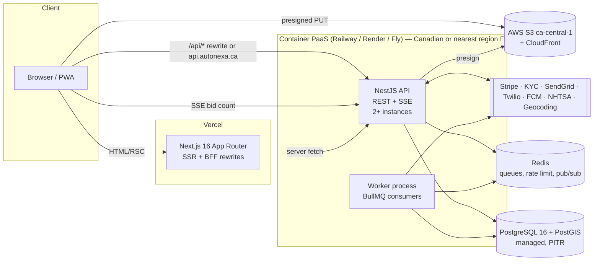

# Scenario 1 — Custom Backend + Custom DB, Frontend on Vercel

> **Variant 1A (primary):** Next.js on Vercel · NestJS API + workers on a container PaaS (Railway / Render / Fly.io) · Managed PostgreSQL + PostGIS · Managed Redis
> Alternative on AWS: [01b-custom-backend-vercel-aws.md](./01b-custom-backend-vercel-aws.md)

---

## 1. Summary & when to choose

The frontend stays where it shines (Vercel: edge CDN, previews, image optimization). A **dedicated TypeScript API** owns all business logic, the database, background jobs, and realtime. This is closest to the SRS intent (Node + Express + SQL + Redis + BullMQ), but replaces the single VPS with managed services so 99.9% and RPO 1 h are achievable without a dedicated ops person.

**Choose when:** you want production-grade correctness, the team is TypeScript-first, and you'd rather pay a modest monthly bill than run servers.
**Avoid when:** the budget must be fixed and tiny, or the client mandates one VPS.

---

## 2. Architecture



**Cookie rule:** host the API at `api.autonexa.ca` (same registrable domain as `autonexa.ca`), or use a Next.js `rewrites()` proxy so `/api/*` stays first-party. Either way, `proxy.ts` can see the `autonexa_rt` refresh cookie.

> [!NOTE]
> Rewrites through Vercel add a hop (~10–40 ms) and are subject to Vercel function limits for proxied streaming. Prefer **direct `api.` subdomain** for SSE.

---

## 3. Tech stack

| Layer | Choice | Notes |
|---|---|---|
| Frontend | Next.js 16 on Vercel | Existing code; Route Handlers become thin BFF/proxy only |
| API runtime | Node.js 22 LTS | |
| API framework | **NestJS 11** (alt: Fastify + plain modules) | Modules map 1:1 to domains; guards for RBAC; DI makes the auction engine unit-testable (NFR-16) |
| Validation | **Zod** shared package (`packages/contracts`) | Same schemas on the frontend (RHF) and the backend; generates OpenAPI |
| ORM / SQL | **Drizzle ORM** (alt: Prisma) | Drizzle gives raw-SQL control for `FOR UPDATE` and PostGIS; Prisma is fine but weaker on PostGIS |
| Database | **PostgreSQL 16 + PostGIS** (managed: Neon, Supabase-DB-only, Crunchy Bridge, Railway PG, or RDS) | SRS allows Postgres; PostGIS beats MySQL spatial for radius queries |
| Cache / queue | **Redis 7** (Upstash / Railway / Render Key Value) | BullMQ, rate limiting, SSE pub/sub |
| Jobs | **BullMQ** delayed jobs + repeatable reconciliation job | Auction close, acceptance expiry, notifications, subscription sync |
| Realtime | **SSE** from NestJS (`@Sse()`), Redis pub/sub fan-out across instances | Matches `architecture.md`; no WebSocket needed (one-way) |
| Auth | Custom JWT (access 15 min) + rotating refresh (HttpOnly, 7 d) + **TOTP MFA** (`otplib`) + argon2id | Matches the existing frontend contract exactly |
| Storage | AWS S3 ca-central-1 + CloudFront; presigned PUT | SRS-mandated |
| Payments | Stripe Billing (CAD) + webhooks | |
| Notifications | SendGrid, Twilio, FCM via queue | Bilingual templates |
| Observability | Sentry, OpenTelemetry → Grafana Cloud / Axiom, UptimeRobot / Better Stack | |
| CI/CD | GitHub Actions → Vercel (frontend), PaaS deploy (API); migrations step | NFR-16 CI gate |
| Repo | Turborepo/pnpm monorepo: `apps/web`, `apps/api`, `packages/contracts` | Shared types; one PR = full-stack change |

---

## 4. Critical flows

### H1/H2 — Sealed, upward-only bid (target < 200 ms)

```ts
// apps/api/src/bids/bids.service.ts (sketch)
async placeBid(dealerId: string, listingId: string, amountCents: bigint, idemKey: string) {
  return this.db.transaction(async (tx) => {
    const [listing] = await tx.execute(sql`
      SELECT id, status, auction_ends_at FROM listings
      WHERE id = ${listingId} FOR SHARE`);
    if (listing.status !== 'ACTIVE' || listing.auction_ends_at <= new Date())
      throw new ConflictException('AUCTION_CLOSED');

    const [existing] = await tx.execute(sql`
      SELECT id, amount_cents FROM bids
      WHERE listing_id = ${listingId} AND dealership_id = ${dealerId}
      FOR UPDATE`);
    if (existing && amountCents < existing.amount_cents)
      throw new UnprocessableEntityException('BID_MUST_NOT_DECREASE');

    if (existing) {
      await tx.execute(sql`UPDATE bids SET amount_cents=${amountCents}, revised_at=now(), version=version+1 WHERE id=${existing.id}`);
    } else {
      await tx.execute(sql`INSERT INTO bids (listing_id, dealership_id, amount_cents, idempotency_key) VALUES (${listingId}, ${dealerId}, ${amountCents}, ${idemKey})`);
      await tx.execute(sql`UPDATE listings SET bid_count = bid_count + 1 WHERE id = ${listingId}`);
    }
    await this.audit.write(tx, { actor: dealerId, action: 'BID_PLACED', entity: listingId });
  }).then(() => this.events.publish(`listing:${listingId}`, { type: 'BID_COUNT' }));
}
```

The seller-facing serializer returns `bidCount` only while `status === 'ACTIVE'`, enforced by a NestJS interceptor plus an integration test that asserts **no `amount_cents` key appears in any seller payload**.

### H3/H4 — Auction close at exactly T+24 h

```ts
// on approval
await auctionQueue.add('close', { listingId }, { delay: endsAt - Date.now(), jobId: `close:${listingId}` });

// worker (idempotent)
const res = await db.execute(sql`UPDATE listings SET status='PENDING_SELECTION'
  WHERE id=${listingId} AND status='ACTIVE' AND auction_ends_at <= now() RETURNING id`);
if (res.rowCount) await notifySellerResults(listingId);

// reconciliation (repeatable every 60 s) — FR-X-02
SELECT id FROM listings WHERE status='ACTIVE' AND auction_ends_at <= now();
```

### H5 — SSE bid count
NestJS `@Sse('listings/:id/stream')` subscribes to Redis channel `listing:{id}` and emits `{ bidCount, auctionEndsAt, serverNow }`. Clients compute the countdown from `auctionEndsAt − serverNow` offset (no client-clock trust).

### H6 — Dealer radius feed
```sql
SELECT l.* FROM listings l
WHERE l.status='ACTIVE'
  AND ST_DWithin(l.location, (SELECT location FROM dealerships WHERE id=$1), $2 * 1000)
ORDER BY l.auction_ends_at ASC LIMIT 50;
-- GiST index on listings.location (geography)
```

### H8 — Audit
`audit_log` table owned by a role with `INSERT`-only grants; nightly job exports to S3 with **Object Lock (compliance mode, 7 y)**.

### H9 — Stripe
`POST /webhooks/stripe` (raw body) → verify signature → upsert `stripe_events(id)` for idempotency → enqueue processing.

---

## 5. NFR compliance

| NFR | Status | How |
|---|---|---|
| 01 Perf | ✅ | API + DB co-located; feed cached in Redis (30 s) |
| 02 Bid < 200 ms | ✅ | Warm containers, short tx, no cold start |
| 03 5k users | ✅ | 2–4 API instances; SSE via Redis pub/sub |
| 04 99.9% | ✅ | Multi-instance API; managed HA Postgres (provider-dependent 🔎) |
| 05 Encryption | ✅ | Managed DB/S3 encryption; argon2id |
| 06 MFA | ✅ | TOTP enforced by role guard |
| 07 Rate limit | ✅ | `@nestjs/throttler` + Redis store |
| 08 Privacy | ✅ | Consent table; export/erasure jobs |
| 09 Residency | ⚠️ | S3 ✅; DB/API region depends on PaaS Canadian availability 🔎 |
| 10 RPO/RTO | ✅ | Managed PITR (choose a provider with PITR) |
| 11 Audit 7 y | ✅ | Append-only + S3 Object Lock |
| 13 i18n | ✅ | Server-side template i18n |
| 14 Cents | ✅ | `bigint` columns |
| 15 Concurrency | ✅ | `FOR UPDATE` + idempotent close |
| 16 Maintainability | ✅ | Services unit-testable; CI gate |

---

## 6. Residency & compliance

- 🔎 **Verify region availability:** Railway, Render, and Fly.io region lists change. If none offers Canada at decision time, use **[01b](./01b-custom-backend-vercel-aws.md)** (AWS ca-central-1) for the API + DB, or accept US-East with a Law 25 PIA.
- Vercel only serves the UI and SSR (minimal PII passes through it). Pin Vercel functions to the region nearest the API (🔎 check for a Canadian Vercel region; otherwise `iad1`/`cle1`).

## 7. Scaling path

1. MVP: 1 API + 1 worker, 1 Postgres primary, 1 Redis.
2. Growth (≥ 5k concurrent): 3–4 API replicas behind the PaaS load balancer, Postgres read replica for the feed, Redis pub/sub for SSE.
3. Beyond: split the worker per queue, move realtime to a dedicated SSE service, introduce CDN caching for public listing pages.

## 8. Cost bands (🔎 estimates, USD/month)

| Item | MVP | Growth |
|---|---|---|
| Vercel Pro | 20 | 20–150 |
| API + worker containers | 20–60 | 100–300 |
| Managed Postgres w/ PITR | 25–70 | 100–400 |
| Redis | 10–30 | 30–100 |
| S3 + CloudFront | 5–20 | 50–200 |
| Sentry / logs / uptime | 0–50 | 50–150 |
| **Total** | **~80–250** | **~350–1,300** |

Excludes Stripe/Twilio/SendGrid/KYC usage fees (the same in every scenario).

## 9. Effort & time-to-MVP

| Workstream | Estimate (2 backend devs) |
|---|---|
| Scaffold monorepo, CI, envs, auth + MFA | 2 weeks |
| Listings, media presign, VIN, KYC webhooks | 2 weeks |
| Auction engine, bids, jobs, SSE (+ tests) | 3 weeks |
| Dealers, Stripe, notifications | 2 weeks |
| Admin, audit, reporting, hardening | 2–3 weeks |
| **Total** | **~11–12 weeks** |

## 10. Risks, lock-in, exit

| Risk | Mitigation |
|---|---|
| More code to own than a BaaS (auth, MFA) | Use vetted libs (argon2, otplib, jose); security review |
| Cross-domain cookie mistakes | `api.` subdomain + `SameSite=Lax; Domain=.autonexa.ca` |
| PaaS region not in Canada | Fall back to 01b |
| **Lock-in** | **Very low.** Plain Docker + Postgres + Redis are portable anywhere |

## 11. Impact on current frontend

- **None to the contract.** Set `NEXT_PUBLIC_API_URL=https://api.autonexa.ca`; mock route handlers stop answering. `architecture.md` invariants stay as-is.
- Move the `lib/types/*` + Zod schemas into `packages/contracts` so the API and UI share them.
