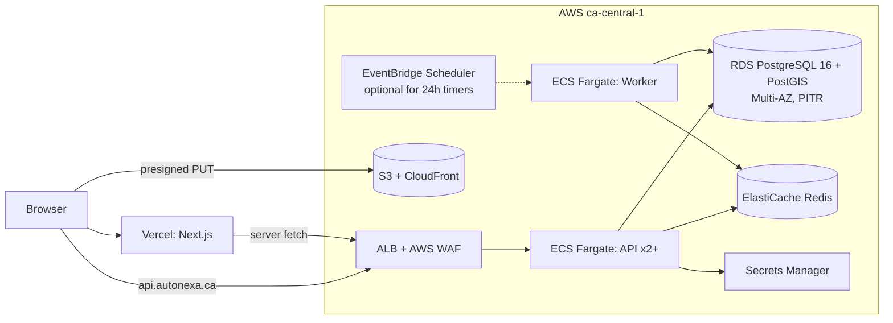

# Scenario 1b — Custom Backend on AWS ca-central-1, Frontend on Vercel

> Alternative to [Scenario 1A](./01-custom-backend-vercel.md). Same NestJS + PostgreSQL design; infrastructure moves to **AWS Canada (Central)** for guaranteed residency and an enterprise-grade SLA.

---

## 1. Summary & when to choose

Keep Vercel for the UI. Run the API, workers, database, and cache on AWS in **ca-central-1**. This is the **most compliant and most scalable** "Vercel frontend" option, at the cost of real cloud-ops work (VPC, IAM, IaC).

**Choose when:** the client cares about PIPEDA/Law 25 audit readiness, expects enterprise dealers, or wants a clear path to SOC 2.
**Avoid when:** no one on the team can own AWS infrastructure, or the MVP date is under 10 weeks.

---

## 2. Architecture

## 3. Tech stack (deltas from 1A)

| Layer | Choice |
|---|---|
| Compute | **ECS Fargate** (alt: App Runner for simpler ops) |
| DB | **RDS PostgreSQL** Multi-AZ, automated backups + PITR (5-min RPO) |
| Cache/queue | ElastiCache Redis (BullMQ) |
| Timers | BullMQ (default) **or** EventBridge Scheduler one-off schedules per auction, which survive any app outage |
| Edge security | AWS WAF on ALB (rate rules, OWASP managed rules) |
| Secrets | Secrets Manager |
| IaC | **Terraform** or **SST v3** |
| Observability | CloudWatch + Sentry + OpenTelemetry |
| Archive | S3 Object Lock (compliance) for the 7-year audit; Glacier lifecycle for completed listing media |

## 4. Critical flows
Identical to [1A §4](./01-custom-backend-vercel.md#4-critical-flows). Optional upgrade: create an EventBridge one-time schedule at `auction_ends_at` that enqueues the close job, so the DB-level reconciliation sweep becomes a second safety net.

## 5. NFR compliance

All ✅. Notable improvements over 1A:
- **NFR-04:** Multi-AZ RDS + multi-task ECS → realistic 99.9–99.95%.
- **NFR-09:** ✅ end-to-end Canadian residency (except the Vercel edge UI).
- **NFR-10:** RDS PITR → RPO ≈ 5 min, RTO < 1 h.
- **NFR-07:** WAF + app throttling.

## 6. Residency & compliance
All PII at rest in ca-central-1. Sign the AWS DPA. Document in the Law 25 privacy register. Vercel processes request data in transit only; note it in the privacy policy.

## 7. Scaling path
ECS service autoscaling on CPU/connection count → RDS read replica → split realtime service → Aurora PostgreSQL if write volume ever demands it (unlikely, see workload model).

## 8. Cost bands (🔎 estimates, USD/month)

| Item | MVP | Growth |
|---|---|---|
| Vercel Pro | 20 | 20–150 |
| ECS Fargate (API + worker) | 60–120 | 200–500 |
| ALB + WAF | 25–40 | 40–80 |
| RDS Multi-AZ (db.t4g.medium) | 120–160 | 300–700 |
| ElastiCache | 25–50 | 60–150 |
| S3/CloudFront/NAT/logs | 40–100 | 150–400 |
| **Total** | **~300–500** | **~800–2,000** |

> [!TIP]
> To cut MVP cost: single-AZ RDS + App Runner + no NAT gateway (public subnets with security groups), then harden before launch.

## 9. Effort
1A estimate **+2–3 weeks** for IaC, networking, and IAM → **~13–15 weeks**.

## 10. Risks, lock-in, exit
- Ops complexity (VPC/NAT/IAM): needs a DevOps-capable engineer.
- Lock-in: **low–medium**. App containers are portable; EventBridge/WAF are AWS-specific but optional.

## 11. Impact on current frontend
Same as 1A: none to the contract.
