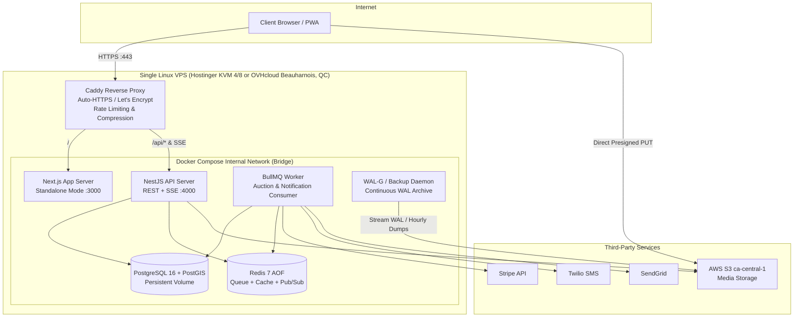

# Scenario 2 — Custom Backend & Database on Self-Hosted VPS (SRS-Faithful)

> **Variant 2 (Single/Dual VPS):** Everything hosted on a dedicated Virtual Private Server (Hostinger / OVHcloud Canada / Hetzner) · Docker Compose · Reverse Proxy (Caddy / Nginx) · PostgreSQL 16 + PostGIS · Redis 7 + BullMQ · Node.js / NestJS API
> Enterprise cloud alternative: [02b-custom-backend-aws-full.md](./02b-custom-backend-aws-full.md)

---

## 1. Summary & when to choose

This is the **literal specification architecture** outlined in the initial SRS: a Node.js + Express/NestJS modular monolith running alongside PostgreSQL and Redis on a single Hostinger (or OVHcloud Canada) VPS. The frontend can either run as a standalone Next.js Node container on the same host or be deployed to Vercel pointing to the VPS IP/domain.

**Choose when:**
- The client demands a **strictly predictable, ultra-low infrastructure budget** ($20–$80/month flat).
- The client explicitly requires a self-contained single-server deployment (e.g., existing Hostinger/OVH account).
- You want zero serverless cold starts, zero usage-based billing spikes, and full root control.

**Avoid when:**
- The team lacks Linux sysadmin/DevOps capability (you own OS updates, firewall, SSL, database backups, monitoring, and failover).
- True 99.9% high availability (NFR-04) is strictly audited with SLA penalties (single VPS = single point of failure).
- Disaster recovery must be automated without manual intervention (RTO < 4h requires disciplined off-site WAL streaming).

---

## 2. Architecture



---

## 3. Tech stack

| Layer | Choice | Rationale & Specifications |
|---|---|---|
| **Host / Hardware** | **OVHcloud VPS** (Beauharnois, QC) or **Hostinger KVM 4/8** | 4–8 vCPU, 8–16 GB RAM, NVMe SSD (~$20–$55/mo). OVH guarantees Canadian residency (QC). |
| **Operating System** | **Ubuntu 24.04 LTS** | Hardened with `ufw`, SSH key-only, fail2ban, automated security patches. |
| **Orchestration** | **Docker Compose v2** | Declarative container stack, health checks, restart policies (`restart: unless-stopped`), isolated bridge network. |
| **Reverse Proxy** | **Caddy v2** (alt: Nginx) | Automatic TLS via Let's Encrypt, HTTP/2 & HTTP/3 support, native reverse proxy with zero-config SSE streaming buffers (`flush_interval -1`). |
| **Web UI** | Next.js 16 (Standalone Output) | Dockerized using Next.js `output: 'standalone'` reducing image size to ~120 MB. |
| **API Runtime** | **NestJS 11** (Node 22 LTS) | Structured modules for Auth, Listings, Bids, Auctions, Dealers, Admin, Audit. Shared Zod contract validation. |
| **Database** | **PostgreSQL 16 + PostGIS** | Official Docker container with dedicated host volume mount. PostGIS extension for dealer geo-fencing (`ST_DWithin`). |
| **Cache & Queue** | **Redis 7** (Alpine) | In-memory with append-only persistence (`appendonly yes`). BullMQ durable jobs, API rate limiting, and Redis Pub/Sub for SSE broadcast. |
| **Background Jobs** | **BullMQ** | Separate worker container process. Manages 24h auction countdowns, 24h acceptance windows, and notification queues. |
| **Realtime** | **Server-Sent Events (SSE)** | Direct persistent HTTP connection to NestJS. Redis pub/sub bridges API instances to client connections. |
| **Backup & DR** | **WAL-G** or **pgBackRest** to S3 | Continuous WAL shipping to AWS S3 `ca-central-1` to guarantee NFR-10 (RPO ≤ 1h, RTO ≤ 4h). |
| **Media Storage** | **AWS S3 ca-central-1** | Presigned direct-to-S3 uploads. Never proxies media through VPS disk or bandwidth. |
| **Observability** | **Prometheus + Grafana + Loki** (or GlitchTip/Sentry) | Lightweight node-exporter + cAdvisor, alerts on disk full, RAM spike, or database crashes. |

---

## 4. Critical flows

### H1/H2 — Sealed Bids & Concurrency Control (ACID Transaction)
Bid placement executes inside a single Postgres transaction with `SELECT ... FOR UPDATE`:

```typescript
// apps/api/src/bids/bids.service.ts
async submitBid(dealershipId: string, listingId: string, amountCents: bigint, idempotencyKey: string) {
  return this.db.transaction(async (tx) => {
    // 1. Verify auction is active and not expired
    const [auction] = await tx.query(
      `SELECT id, status, auction_ends_at FROM listings WHERE id = $1 FOR SHARE`,
      [listingId]
    );
    if (!auction || auction.status !== 'ACTIVE' || new Date() >= auction.auction_ends_at) {
      throw new BadRequestException('AUCTION_NOT_ACTIVE');
    }

    // 2. Lock dealer's existing bid row for update
    const [existingBid] = await tx.query(
      `SELECT id, amount_cents FROM bids WHERE listing_id = $1 AND dealership_id = $2 FOR UPDATE`,
      [listingId, dealershipId]
    );

    if (existingBid) {
      if (amountCents <= existingBid.amount_cents) {
        throw new UnprocessableEntityException('BID_MUST_BE_GREATER_THAN_PREVIOUS');
      }
      await tx.query(
        `UPDATE bids SET amount_cents = $1, revised_at = NOW(), version = version + 1 WHERE id = $2`,
        [amountCents, existingBid.id]
      );
    } else {
      await tx.query(
        `INSERT INTO bids (id, listing_id, dealership_id, amount_cents, idempotency_key, created_at)
         VALUES (gen_random_uuid(), $1, $2, $3, $4, NOW())`,
        [listingId, dealershipId, amountCents, idempotencyKey]
      );
      // Atomically increment bid count
      await tx.query(`UPDATE listings SET bid_count = bid_count + 1 WHERE id = $1`, [listingId]);
    }

    // 3. Write immutable audit log row within the same tx
    await tx.query(
      `INSERT INTO audit_logs (id, actor_id, action, target_entity, target_id, created_at)
       VALUES (gen_random_uuid(), $1, 'BID_SUBMITTED', 'listings', $2, NOW())`,
      [dealershipId, listingId]
    );
  }).then(async () => {
    // 4. Publish real-time SSE event through Redis pub/sub
    await this.redis.publish(`auction:${listingId}:telemetry`, JSON.stringify({
      type: 'BID_INCREMENT',
      listingId,
      timestamp: Date.now()
    }));
  });
}
```

### H3/H4 — Durable 24h Timers & Safe Auction Closing
Timers are scheduled in BullMQ on listing approval. As a fail-safe against VPS reboots or delayed jobs (FR-X-02), a reconciliation cron runs every 60 seconds:

```typescript
// BullMQ Auction Worker Consumer
@Processor('auction-lifecycle')
export class AuctionLifecycleConsumer extends WorkerHost {
  async process(job: Job<{ listingId: string }>) {
    const { listingId } = job.data;
    await this.closeAuctionIdempotently(listingId);
  }

  // Idempotent close
  async closeAuctionIdempotently(listingId: string) {
    const result = await this.db.query(
      `UPDATE listings 
       SET status = 'PENDING_SELECTION', closed_at = NOW() 
       WHERE id = $1 AND status = 'ACTIVE' AND auction_ends_at <= NOW()
       RETURNING id, seller_id, reserve_met`,
      [listingId]
    );

    if (result.rowCount > 0) {
      // Transition succeeded on this node
      await this.notificationQueue.add('send-seller-auction-ended', { listingId });
      await this.notificationQueue.add('schedule-acceptance-deadline', { 
        listingId,
        delay: 24 * 60 * 60 * 1000 
      });
    }
  }
}

// System-wide reconciliation sweep (runs every minute in worker)
@Cron(CronExpression.EVERY_MINUTE)
async reconcileExpiredAuctions() {
  const expired = await this.db.query(
    `SELECT id FROM listings WHERE status = 'ACTIVE' AND auction_ends_at <= NOW()`
  );
  for (const row of expired.rows) {
    await this.closeAuctionIdempotently(row.id);
  }
}
```

---

## 5. NFR matrix evaluation

| NFR | Requirement | Status | How It Is Satisfied on VPS |
|---|---|:---:|---|
| **NFR-01** | Page load < 2s; API < 500ms | **✅** | Co-located API, Redis, and Postgres on local UNIX sockets / bridge network yields < 5ms DB roundtrip. Caddy provides gzip/brotli. |
| **NFR-02** | **Bid submission < 200ms** | **✅** | Zero container cold start; local ACID transaction executes in ~15–30ms. |
| **NFR-03** | **5,000 users, 1,000 auctions** | **⚠️** | An 8 vCPU / 16 GB RAM VPS handles 5k idle SSE connections and ~25 bids/s. However, vertical limits exist; horizontal scaling requires an external load balancer and database separation. |
| **NFR-04** | **99.9% availability** | **⚠️** | A single VPS has an infrastructure SLA of 99.9% from the provider, but maintenance/reboots cause downtime. Achieving true 99.9% requires a standby replica or automated failover. |
| **NFR-05** | Encryption (TLS 1.3, AES-256) | **✅** | Caddy handles TLS 1.3 with A+ SSL labs rating. Postgres tablespace encryption or LUKS disk encryption on VPS host. |
| **NFR-06** | **MFA (TOTP) for Admins** | **✅** | Handled natively by NestJS `otplib` and database session storage. |
| **NFR-07** | Rate limiting & OWASP | **✅** | Caddy rate limiting + `@nestjs/throttler` backed by local Redis. |
| **NFR-08** | Privacy (PIPEDA & Law 25) | **✅** | VPS hosted in OVHcloud Beauharnois (Quebec, Canada) guarantees 100% data residency inside Quebec/Canada. |
| **NFR-09** | Canadian data residency | **✅** | Compute and database reside physically in Canada. S3 bucket in `ca-central-1`. |
| **NFR-10** | **RPO 1h, RTO 4h** | **⚠️** | Plain 6-hour mysqldump fails RPO 1h. **Must use continuous WAL streaming (WAL-G)** shipping to S3 to guarantee RPO < 15 min and RTO < 2h. |
| **NFR-11** | 7-year audit trail | **✅** | Append-only Postgres table exported nightly to AWS S3 Glacier/Object Lock. |
| **NFR-14** | Monetary integer cents | **✅** | Postgres `BIGINT` columns; strict TS domain types. |
| **NFR-15** | Idempotency & Concurrency | **✅** | Postgres `SELECT ... FOR UPDATE` and unique constraints on `idempotency_key`. |
| **NFR-16** | 70% Unit test coverage | **✅** | Plain TypeScript services easily mockable with Jest/Vitest; runs cleanly in GitHub Actions CI. |

---

## 6. Data residency & legal compliance (PIPEDA & Quebec Law 25)

- **Physical Location:** If using **OVHcloud (BHS data center, Beauharnois, Quebec)**, both data at rest and data in transit remain inside Quebec, exceeding Quebec Law 25 cross-border transfer restrictions.
- **S3 Media:** Presigned URLs point to AWS S3 in `ca-central-1` (Montreal).
- **Access Logs:** Stored locally in `/var/log` and shipped to Canadian S3 or retained for audit compliance.

---

## 7. Scaling path & bottleneck resolution

1. **Phase 1 (MVP — 0 to 1,500 active dealers):** Single VPS (8 vCPU, 16 GB RAM) handles Web + API + Worker + DB + Redis easily.
2. **Phase 2 (Growth — 1,500 to 5,000 active dealers):** 
   - Move PostgreSQL to a dedicated DB VPS with streaming replication.
   - Run Caddy + Next.js + NestJS on the primary app VPS.
3. **Phase 3 (Enterprise scale > 10,000 concurrent users):** 
   - Migrate Docker containers to a managed Kubernetes cluster or multi-node container service (Scenario 1 or 2b).

---

## 8. Cost bands (Estimates in CAD/month)

| Component | MVP (Single VPS) | Scaled (App VPS + DB VPS) |
|---|---|---|
| OVHcloud VPS (8 vCPU, 16 GB, 160 GB NVMe) | ~$55 CAD | ~$55 CAD (App Server) |
| Dedicated DB VPS (4 vCPU, 8 GB, 80 GB NVMe) | — | ~$35 CAD (Database Server) |
| AWS S3 `ca-central-1` + CloudFront CDN | ~$15 CAD | ~$65 CAD |
| Domain, DNS, Backups (S3 egress/storage) | ~$10 CAD | ~$20 CAD |
| Third-party SaaS (SendGrid, Twilio, Stripe) | Variable / Usage | Variable / Usage |
| **Total Hosting Infrastructure** | **~$80 CAD / month** | **~$175 CAD / month** |

*Note: This is by far the lowest monthly financial overhead of any scenario.*

---

## 9. Effort & time-to-MVP

| Workstream | Estimate (2 Full-Stack Engineers) |
|---|---|
| VPS Setup, Linux hardening, Docker Compose, Caddy TLS & CI/CD deployment | 1.5 weeks |
| Modular Monolith API scaffolding, DB migrations, Auth + MFA | 2.5 weeks |
| Vehicle listing wizard backend, S3 presigned PUT integration, VIN lookup | 2.0 weeks |
| Auction engine, concurrency locks, BullMQ timers & SSE broadcast | 3.0 weeks |
| Dealer subscriptions, Stripe billing webhooks & distance queries | 2.0 weeks |
| Admin panel, dispute management, 7-year audit exporter | 2.0 weeks |
| **Total Time-to-Production** | **~12–13 weeks** |

---

## 10. Risks, lock-in & exit strategy

| Risk | Impact | Mitigation Strategy |
|---|---|---|
| **Single point of failure (Hardware crash)** | High | Automated continuous WAL archiving to S3; automated restore script tested bi-weekly in CI. |
| **Sysadmin overhead (Security patches)** | Medium | Unattended upgrades enabled on Ubuntu; containerized dependencies isolate system packages. |
| **Disk space exhaustion (Logs/DB)** | Medium | Docker log rotation (`max-size: 50m`), automated S3 pruning for old logs, disk alerts at 80% usage. |
| **Vendor Lock-in** | **ZERO** | Everything is 100% open-source Docker, PostgreSQL, and Node.js. Can migrate in 2 hours to AWS, DigitalOcean, or bare-metal. |

---

## 11. Impact on current Next.js frontend

- **Zero Breaking Changes:** The frontend connects via `NEXT_PUBLIC_API_URL=https://api.autonexa.ca`.
- **Packaging:** The Next.js repository adds a production `Dockerfile` with `output: 'standalone'` enabled in `next.config.js`.
- **Route Handlers:** Existing frontend BFF route handlers proxy directly to the VPS internal IP or can be phased out in favor of direct client-to-API calls with HttpOnly cookie support.
