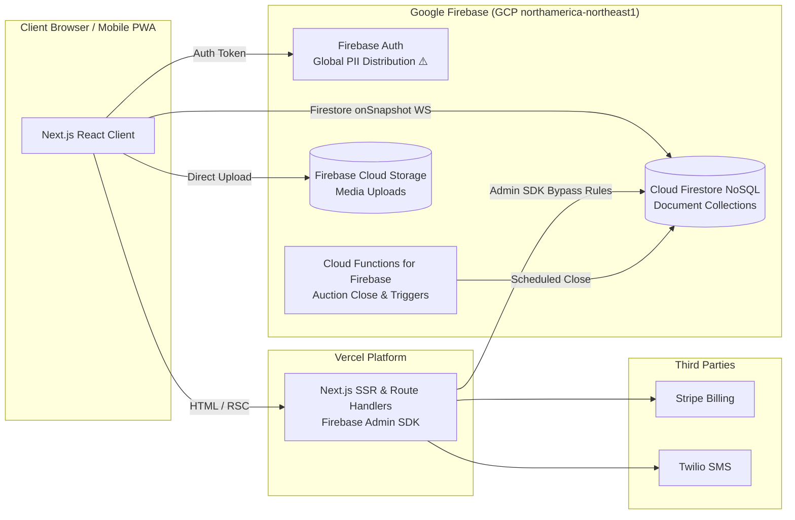

# Scenario 3b — Next.js + Firebase on Vercel (Documented, Not Recommended)

> **BaaS Variant 3B:** Next.js on Vercel · Google Firebase (Cloud Firestore, Firebase Auth, Cloud Functions, Cloud Storage)
> Recommended BaaS alternative: [03-nextjs-supabase-vercel.md](./03-nextjs-supabase-vercel.md)

---

## 1. Summary & why it is NOT recommended

Firebase was evaluated as a candidate for rapid Next.js development. While Firebase is widely used for mobile apps and document-centric MVPs, **it is a fundamental architectural mismatch for the AutoNexa / CAMP auction platform**. 

The automotive auction marketplace domain requires **strict relational integrity, ACID transactions with row-level locks, spatial geographic queries (dealer radius), and zero-leak sealed-bid privacy**. Firestore is a NoSQL document database that lacks native relational joins, lacks PostGIS-equivalent spatial queries, has document-level read security that complicates partial field masking, and charges per document read—making high-frequency auction telemetry prohibitively expensive and prone to data anomalies.

**Choose when:**
- Building a simple non-relational mobile chat app or basic content catalogue.
- The team has deep legacy expertise in Firebase and zero SQL knowledge.

**Avoid when (Our Verdict):**
- **Strongly Avoid for CAMP.** Using Firebase for this project will lead to technical debt, security workarounds for sealed bids, and an inevitable rewrite when dealer volume scales.

---

## 2. Architecture



---

## 3. Tech stack & limitations

| Component | Firebase Tool | Critical Limitation for AutoNexa / CAMP |
|---|---|---|
| **Database** | **Cloud Firestore** | **NoSQL Document Store.** No SQL joins. Denormalization is required across vehicles, listings, bids, and dealerships, creating high risk of stale or unsynchronized data. |
| **Bidding Transactions** | **Firestore `runTransaction`** | High contention failure: Firestore transactions fail if the same document is updated concurrently (1 write/second hard limit on a single document). |
| **Sealed Bids** | **Security Rules** | Firestore Security Rules operate at the **document level**, not the field level. You cannot hide `amount_cents` while revealing `bid_count` on the same document without splitting bids into disconnected sub-collections. |
| **Dealer Geo-radius** | **Geohashes (GeoFirestore)** | No native PostGIS. Requires complex bounding-box client-side filtering. Cannot combine geo-queries with multi-attribute filters (e.g. Make, Year, Mileage, Distance). |
| **Timers & Closings** | **Cloud Tasks / Cloud Scheduler** | Requires deploying GCP Cloud Functions and Cloud Tasks; cold starts add 1–3s latency to webhook executions. |
| **Authentication** | **Firebase Auth** | MFA (TOTP) requires Firebase Identity Platform upgrade (Google Cloud enterprise tier, incurring separate per-SMS/per-MFA charges). |
| **Data Residency** | **GCP Montreal Region** | While Firestore can be pinned to `northamerica-northeast1`, Firebase Authentication metadata is replicated globally across Google data centers, presenting PIPEDA/Law 25 compliance risks. |

---

## 4. Hard problem analysis (Why Firebase struggles with H1–H12)

### H1 — Sealed-Bid Privacy: Document-Level Rule Defect
In Firestore, a client either has permission to read a document or does not. You cannot permit a dealer to view a listing document while stripping out other dealers' bid values in the same payload.
- **The Workaround:** You must create separate collections: `/listings/{id}` (public metadata) and `/listings/{id}/private_bids/{bidId}` (restricted). Every bid submission requires a multi-document Cloud Function write to update the private bid and increment the public counter, introducing eventual consistency lag.

### H2 — Race-Safe Bidding Contention
In an active auction with 20 dealers competing in the final 5 minutes, concurrent writes to the same listing document trigger Firestore transaction retries and contention errors (`ABORTED: too much contention on this document`). Relational Postgres handles this gracefully via row-level locks on the bidder's row (`SELECT ... FOR UPDATE`).

### H6 — Dealer Distance Calculations (Lack of PostGIS)
In Postgres / PostGIS, radius matching is a one-line SQL query:
```sql
WHERE ST_DWithin(l.location, d.location, 50000)
```
In Firebase, Firestore does not support geospatial indexes. You must implement Geohashing, query a square bounding box, fetch excess records, and filter the Euclidean distance in JavaScript, costing thousands of wasteful document reads.

### Cost Explosion Under High Telemetry
Firestore charges **$0.06 per 100,000 document reads**. If 5,000 active dealers are watching a live marketplace feed with 1,000 open auctions:
- Every inventory refresh or real-time snapshot update generates document reads for each vehicle watched.
- 5,000 dealers × 20 listing updates/hour × 8 hours = **800,000+ reads/day** solely for feed browsing, resulting in an unpredictable and rapidly ballooning monthly bill compared to Supabase's or Postgres's fixed compute pricing.

---

## 5. NFR matrix evaluation

| NFR | Requirement | Status | Firebase Scorecard |
|---|---|:---:|---|
| **NFR-01** | Page load < 2s; API < 500ms | **⚠️** | Firestore cold queries from Vercel add 250–600ms latency without connection pooling. |
| **NFR-02** | **Bid submission < 200ms** | **❌** | Multi-document Cloud Function transactions often take 350–800ms under contention. |
| **NFR-03** | 5,000 users, 1,000 auctions | **⚠️** | Massive document read charges under real-time snapshot listeners. |
| **NFR-04** | 99.9% availability | **✅** | Google Cloud global multi-region infrastructure provides strong base uptime. |
| **NFR-05** | Encryption (AES-256) | **✅** | Default Google Cloud encryption at rest. |
| **NFR-06** | **MFA (TOTP) for Admins** | **⚠️** | Requires GCP Identity Platform upgrade; complex setup compared to Supabase's native TOTP. |
| **NFR-07** | Rate limiting & OWASP | **⚠️** | Must be implemented manually in Next.js Route Handlers. |
| **NFR-08** | Privacy (PIPEDA & Law 25) | **⚠️** | Firebase Auth user records and telemetry logs do not strictly stay within Quebec borders. |
| **NFR-09** | Canadian data residency | **⚠️** | Firestore supports `northamerica-northeast1`, but auxiliary Firebase features (Extensions, Auth) route through the US. |
| **NFR-10** | RPO 1h, RTO 4h | **❌** | Firestore does NOT offer native Point-In-Time Recovery (PITR) with continuous WAL archiving; exports are scheduled daily or hourly snapshots only. |
| **NFR-14** | Monetary integer cents | **✅** | Stored as integer numbers in documents. |
| **NFR-15** | Idempotency & Locking | **❌** | No row-level locking or SQL constraints; relies on optimistic concurrency checks that abort under load. |
| **NFR-16** | 70% Unit test coverage | **⚠️** | Testing Firebase Security Rules requires running the local Firebase Emulator Suite in CI, which is slow and brittle. |

---

## 6. Conclusion & verdict

| Factor | Supabase | Firebase |
|---|---|---|
| **Data Model** | Relational SQL (Postgres 16) — **Native Fit** | NoSQL Document Store — **Poor Fit** |
| **Sealed-Bid Security** | Native RLS + Database Views | Split collections + Cloud Functions |
| **Dealer Geo Radius** | PostGIS `ST_DWithin` (Accurate & Fast) | Geohash client-side bounding box |
| **Realtime Pricing** | Unlimited messages on compute plan | Per-document read billing (Uncapped) |
| **MFA Support** | Built-in TOTP MFA out of the box | Requires GCP Identity Platform upgrade |
| **Backup & Recovery** | 5-minute Point-In-Time Recovery (PITR) | Scheduled snapshot dumps only |
| **Canadian Residency** | Full AWS `ca-central-1` project isolation | Fragmented (Auth US, Firestore Canada) |

**Recommendation:** Reject Firebase for the AutoNexa / CAMP platform. If a BaaS is chosen, **Supabase is vastly superior in every technical, compliance, and financial dimension.**
