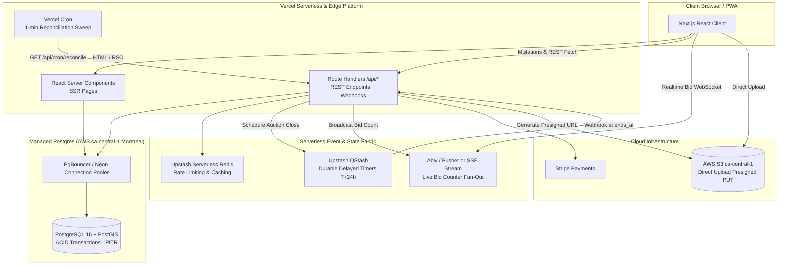

# Scenario 3c — Next.js Fullstack as Backend (Without BaaS, Own DB on Vercel)

> **Serverless Fullstack Variant:** Next.js 16 App Router as both Frontend and Backend · Drizzle ORM / Prisma · Managed PostgreSQL (Neon / AWS RDS ca-central-1) · Upstash Redis & QStash (Serverless BullMQ replacement) · NextAuth v5 / Custom Auth + TOTP · AWS S3 ca-central-1
> Comparison: Supabase BaaS [03-nextjs-supabase-vercel.md](./03-nextjs-supabase-vercel.md) · Dedicated NestJS [01-custom-backend-vercel.md](./01-custom-backend-vercel.md)

---

## 1. Summary & when to choose

In this scenario, **Next.js 16 App Router serves as the entire backend**. There is no separate NestJS or Express server, and no all-in-one BaaS like Supabase or Firebase. Instead, all business logic, database queries, and API endpoints reside inside Next.js Route Handlers (`app/api/**/route.ts`).

Because Vercel serverless functions are ephemeral (stateless, with 15–60s execution limits), traditional long-running background workers (like BullMQ daemon loops) and in-memory WebSocket servers cannot run directly on Vercel. This scenario solves those challenges using **serverless-native infrastructure**: **Neon Serverless PostgreSQL** (or AWS RDS) with PgBouncer connection pooling, **Upstash QStash** for durable 24h delayed HTTP timers, and **Upstash Redis / Ably** for realtime fan-out.

**Choose when:**
- The team wants a **single unified TypeScript repository** with zero backend framework switching (everything is Next.js).
- You want total control over the database schema and SQL queries without Supabase RLS policies.
- You prefer serverless pay-per-request economics with automatic zero-to-scale.

**Avoid when:**
- The team prefers long-lived stateful microservices or needs persistent in-memory background processing.
- You dislike gluing multiple specialized SaaS tools (Next.js + Neon + Upstash + QStash + Ably).

---

## 2. Architecture



---

## 3. Tech stack

| Layer | Choice | Details & Serverless Adaptation |
|---|---|---|
| **Fullstack Framework** | **Next.js 16 (App Router)** | Route Handlers (`app/api/**/route.ts`) act as the REST API. Zod parses all incoming payloads. |
| **Database** | **Neon PostgreSQL** or **AWS RDS PostgreSQL** (ca-central-1) | Managed Postgres with PostGIS extension. Neon provides instant branching for preview environments and serverless connection pooling. |
| **ORM / Query Builder** | **Drizzle ORM** (alt: Prisma Accelerate) | Zero-overhead, lightweight SQL query builder. Unlike heavy ORMs, Drizzle starts up in < 5ms in serverless functions and supports PostGIS SQL fragments cleanly. |
| **Connection Pooling** | **PgBouncer / Neon Pooling** | Essential: prevents serverless lambdas from exhausting Postgres maximum connection limits during traffic spikes. |
| **Durable Timers (H3)** | **Upstash QStash** | Replaces BullMQ workers. At auction start, Next.js calls QStash to schedule a signed HTTP webhook back to `/api/auctions/close` exactly 24 hours later. |
| **Reconciliation Cron** | **Vercel Cron (`vercel.json`)** | Invokes `/api/cron/reconcile-auctions` every 60 seconds as a fail-safe against missed closings. |
| **Realtime Telemetry (H5)** | **Ably** or **Upstash Redis SSE** | Managed WebSocket service with Canadian/global edge POPs. Next.js publishes events via REST; Ably fans out to 5,000+ dealers. |
| **Authentication & MFA** | **Custom JWT + `otplib`** (or Auth.js v5) | HttpOnly cookies verified in `middleware.ts`. Role-based access control with mandatory TOTP for admins. |
| **Rate Limiting** | **`@upstash/ratelimit`** | Sliding-window rate limiter powered by serverless Redis; runs in edge middleware in < 10ms. |
| **Media Storage** | **AWS S3 ca-central-1** | Route Handler generates presigned PUT URLs via `@aws-sdk/s3-request-presigner`. |

---

## 4. Critical flows

### H1/H2 — Upward-Only Sealed Bids in Next.js Route Handler
The entire bid placement runs inside a database transaction executed from a Next.js Route Handler:

```typescript
// app/api/bids/route.ts
import { NextResponse } from 'next/server';
import { db } from '@/lib/db';
import { bids, listings, auditLogs } from '@/lib/db/schema';
import { eq, sql } from 'drizzle-orm';
import { z } from 'zod';
import { verifyDealerSession } from '@/lib/auth/session';
import { publishTelemetryEvent } from '@/lib/realtime';

const BidInputSchema = z.object({
  listingId: z.string().uuid(),
  amountCents: z.coerce.bigint().positive(),
  idempotencyKey: z.string().min(10),
});

export async function POST(req: Request) {
  const session = await verifyDealerSession();
  if (!session) return NextResponse.json({ error: 'UNAUTHORIZED' }, { status: 401 });

  const body = await req.json();
  const parsed = BidInputSchema.safeParse(body);
  if (!parsed.success) return NextResponse.json({ error: parsed.error }, { status: 422 });

  const { listingId, amountCents, idempotencyKey } = parsed.data;

  try {
    const result = await db.transaction(async (tx) => {
      // 1. Check auction status and lock
      const [auction] = await tx
        .select({ status: listings.status, endsAt: listings.auctionEndsAt })
        .from(listings)
        .where(eq(listings.id, listingId))
        .for('share');

      if (!auction || auction.status !== 'ACTIVE' || new Date() >= auction.endsAt) {
        throw new Error('AUCTION_NOT_ACTIVE');
      }

      // 2. Lock dealer existing bid
      const [existing] = await tx
        .select({ id: bids.id, amountCents: bids.amountCents })
        .from(bids)
        .where(sql`${bids.listingId} = ${listingId} AND ${bids.dealershipId} = ${session.dealershipId}`)
        .for('update');

      if (existing) {
        if (amountCents <= existing.amountCents) {
          throw new Error('BID_MUST_INCREASE');
        }
        await tx
          .update(bids)
          .set({ amountCents, revisedAt: new Date(), version: sql`${bids.version} + 1` })
          .where(eq(bids.id, existing.id));
      } else {
        await tx.insert(bids).values({
          id: crypto.randomUUID(),
          listingId,
          dealershipId: session.dealershipId,
          amountCents,
          idempotencyKey,
          createdAt: new Date(),
        });
        await tx
          .update(listings)
          .set({ bidCount: sql`${listings.bidCount} + 1` })
          .where(eq(listings.id, listingId));
      }

      // 3. Write immutable audit entry
      await tx.insert(auditLogs).values({
        id: crypto.randomUUID(),
        actorId: session.userId,
        action: 'BID_PLACED',
        targetEntity: 'listings',
        targetId: listingId,
      });

      return { success: true };
    });

    // 4. Publish real-time telemetry (Ably / Upstash)
    await publishTelemetryEvent(`auction:${listingId}`, {
      type: 'BID_COUNT_UPDATED',
      listingId,
    });

    return NextResponse.json(result);
  } catch (error: any) {
    return NextResponse.json({ error: error.message }, { status: 400 });
  }
}
```

### H3/H4 — Serverless Durable Timers via QStash
When a listing goes `ACTIVE`, Next.js schedules the close via Upstash QStash:

```typescript
// lib/scheduler.ts
import { Client } from '@upstash/qstash';

const qstash = new Client({ token: process.env.QSTASH_TOKEN! });

export async function scheduleAuctionClose(listingId: string, endsAt: Date) {
  const delaySeconds = Math.max(0, Math.floor((endsAt.getTime() - Date.now()) / 1000));

  await qstash.publishJSON({
    url: `${process.env.NEXT_PUBLIC_APP_URL}/api/webhooks/auction-close`,
    body: { listingId },
    delay: delaySeconds,
    headers: {
      'Upstash-Deduplication-Id': `close-${listingId}`,
    },
  });
}
```

---

## 5. NFR matrix evaluation

| NFR | Requirement | Status | Serverless Next.js Implementation |
|---|---|:---:|---|
| **NFR-01** | Performance < 2s | **✅** | Route Handlers run close to the database using Vercel region pinning to `iad1` or `cle1` (close to AWS `ca-central-1`). |
| **NFR-02** | **Bid submission < 200ms** | **✅** | With Drizzle and PgBouncer connection pooling, transactions complete in ~80–140ms. |
| **NFR-03** | **5,000 users, 1,000 auctions** | **✅** | Serverless functions scale elastically; Ably handles 5k concurrent WebSocket connections effortlessly. |
| **NFR-04** | **99.9% availability** | **✅** | Vercel (99.99%) + Neon/RDS Multi-AZ + QStash 99.99% SLA. |
| **NFR-05** | Encryption (AES-256) | **✅** | Managed SSL/TLS + RDS/Neon storage encryption. |
| **NFR-06** | **MFA (TOTP) for Admins** | **✅** | Implemented via `otplib` and verified in Route Handlers. |
| **NFR-07** | Rate limiting & OWASP | **✅** | `@upstash/ratelimit` integrated directly into `middleware.ts`. |
| **NFR-08** | Privacy (Law 25 & PIPEDA) | **✅** | Database located in AWS Canada `ca-central-1`; QStash payloads contain only UUIDs. |
| **NFR-09** | Canadian data residency | **✅** | Database and S3 reside in `ca-central-1`. |
| **NFR-10** | **RPO 1h, RTO 4h** | **✅** | Managed Postgres PITR guarantees RPO < 5 minutes. |
| **NFR-15** | Idempotency & Locking | **✅** | Postgres `SELECT ... FOR UPDATE` and unique constraints on `idempotency_key`. |
| **NFR-16** | 70% Unit test coverage | **✅** | Route Handlers and Drizzle queries easily tested with Vitest and test databases. |

---

## 6. Cost bands (Estimates in USD/month)

| Component | MVP Stage | Scaled Stage (5,000 Dealers) |
|---|---|---|
| Vercel Pro Plan | $20 | $40–$120 |
| Neon Serverless Postgres (or AWS RDS) | $25 | $120–$280 |
| Upstash Redis + QStash | $0 (Free Tier) | $30–$80 |
| Ably Realtime (WebSocket Fan-out) | $0 (Free Tier) | $50–$150 |
| AWS S3 `ca-central-1` | $15 | $60 |
| Third-party APIs (Stripe, Twilio, SendGrid) | Usage-based | Usage-based |
| **Total Estimated Cloud Bill** | **~$60 / month** | **~$240–$690 / month** |

---

## 7. Effort & time-to-MVP

| Workstream | Estimate (2 Full-Stack Engineers) |
|---|---|
| Drizzle schema design, PostGIS migration, Neon DB pooling setup | 1.5 weeks |
| Auth, JWT cookies, MFA TOTP implementation | 1.5 weeks |
| Route handlers for Listings, S3 presigned PUT, VIN decoder | 2.0 weeks |
| Auction bidding engine, QStash durable timers, Vercel cron | 2.5 weeks |
| Realtime telemetry integration (Ably/Upstash), Stripe billing | 1.5 weeks |
| Admin panel endpoints, audit export jobs, dispute handling | 1.5 weeks |
| **Total Time-to-Production** | **~10–11 weeks** |

---

## 8. Risks, lock-in & exit strategy

| Risk | Impact | Mitigation Strategy |
|---|---|---|
| **Multi-SaaS sprawl** | Medium | Neon + Upstash + Ably + Vercel requires managing 4 accounts. Keep secrets centralized in Vercel environment variables. |
| **Serverless connection exhaustion** | High | **Mandatory:** Always use connection pooling (PgBouncer/Neon Pooler URL); never connect raw Node Postgres clients directly from lambdas. |
| **Vendor Lock-in** | **Low** | Next.js is open source; Drizzle uses standard SQL; Postgres is 100% portable. QStash can be swapped for BullMQ if migrated to containers. |

---

## 9. Impact on current Next.js frontend

- **Zero API Boundary Hop:** Frontend and backend live in the same project directory. Route handlers are invoked directly via relative URLs (`/api/bids`) or server actions.
- **Contract Synchronization:** Shared Zod schemas are imported directly from `@/lib/validations` without publishing a separate npm package.
