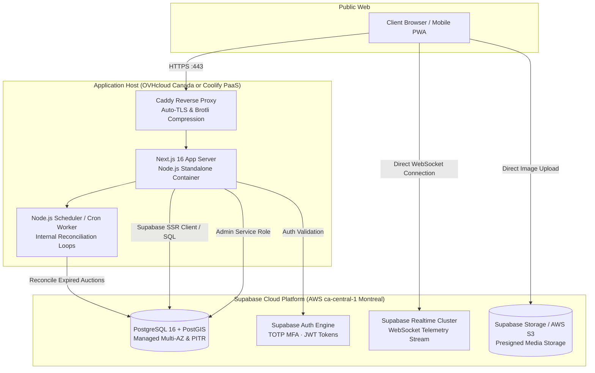

# Scenario 4 — Next.js Container Off-Vercel + Supabase Cloud

> **Hybrid Variant:** Next.js 16 Standalone Container on self-hosted VPS / Coolify / Railway · Supabase Cloud (AWS `ca-central-1` Montreal) for Postgres, Auth, Realtime & Storage
> Fully self-hosted variant: [04b-self-hosted-supabase.md](./04b-self-hosted-supabase.md) · Vercel + Supabase: [03-nextjs-supabase-vercel.md](./03-nextjs-supabase-vercel.md)

---

## 1. Summary & when to choose

This hybrid scenario pairs the **managed database and realtime power of Supabase Cloud** with a **self-hosted Next.js app container** deployed outside of Vercel (e.g., on an OVHcloud Canada VPS, Hetzner, Coolify, or Railway). 

It eliminates Vercel's team seat charges, serverless function timeouts, and expensive bandwidth markups, while avoiding the massive operational burden of managing and patching a raw PostgreSQL cluster.

**Choose when:**
- The client wants the developer speed and features of Supabase (Auth with MFA, Realtime, PostGIS, automated PITR) but refuses to pay Vercel's recurring enterprise subscription or bandwidth fees.
- You need long-lived background threads or continuous server-side event consumers inside the Next.js process that exceed serverless function timeouts.

**Avoid when:**
- The team has zero desire to maintain even a single container or Linux host (choose Scenario 3 instead).
- The client mandates that no third-party BaaS vendor can hold database credentials.

---

## 2. Architecture

---

## 3. Tech stack

| Layer | Choice | Details |
|---|---|---|
| **App Hosting** | **OVHcloud Canada VPS** (or Coolify PaaS) | 4 vCPU, 8 GB RAM Linux host running Dockerized Next.js. Flat ~$25–$45 CAD/mo. |
| **Reverse Proxy** | **Caddy v2** | Automatic Let's Encrypt TLS, HTTP/3, reverse proxy to Next.js `:3000`. |
| **Frontend Runtime** | **Next.js 16 (Standalone Output)** | Built with `output: 'standalone'`, runs as a high-performance persistent Node.js process without serverless timeouts. |
| **Database** | **Supabase Cloud (AWS ca-central-1)** | Fully managed Postgres 16, PostGIS, Supavisor connection pooling, automated backups, and 5-min PITR. |
| **Authentication** | **Supabase Auth** | Built-in TOTP MFA for Admin/Dealer roles; session cookies verified server-side in Next.js middleware. |
| **Realtime Engine** | **Supabase Realtime (Managed WebSockets)** | Clients connect directly to Supabase Realtime channels. Zero WebSocket connection burden on the Next.js app host. |
| **Timers & Closings** | **`pg_cron` (in Supabase) + Local Node.js Scheduler** | Dual-layer: `pg_cron` runs inside Postgres every minute; the Next.js container runs an in-process agenda/bree worker for reliable notification dispatches. |
| **Storage** | **AWS S3 / Supabase Storage (`ca-central-1`)** | Direct uploads via presigned URLs with client-side image compression. |

---

## 4. NFR matrix evaluation

| NFR | Requirement | Status | How It Is Satisfied |
|---|---|:---:|---|
| **NFR-01** | Performance < 2s | **✅** | Standalone Node.js has zero cold starts; persistent database connection pool to Supabase in Montreal. |
| **NFR-02** | **Bid submission < 200ms** | **✅** | Stored procedure (`submit_dealer_bid`) runs directly in Postgres in ~20–35ms. |
| **NFR-03** | 5,000 users, 1,000 auctions | **✅** | App container handles SSR and API; Supabase Realtime cluster absorbs all 5,000 concurrent WebSocket connections. |
| **NFR-04** | 99.9% availability | **✅** | Supabase managed SLA (99.9%); App VPS monitored with auto-restart policies. |
| **NFR-05** | Encryption (AES-256) | **✅** | Supabase managed encryption at rest; TLS 1.3 on Caddy. |
| **NFR-06** | **MFA (TOTP) for Admins** | **✅** | Native Supabase TOTP MFA. |
| **NFR-07** | Rate limiting & OWASP | **✅** | Caddy rate limiting at reverse proxy + in-memory token bucket in Next.js. |
| **NFR-08** | Privacy (Law 25 & PIPEDA) | **✅** | Both App host (OVH Montreal) and Supabase project (AWS Montreal) are physically in Quebec, Canada. |
| **NFR-09** | Canadian data residency | **✅** | 100% Canadian residency at rest and in transit. |
| **NFR-10** | **RPO 1h, RTO 4h** | **✅** | Supabase Pro continuous PITR guarantees RPO < 5 minutes. |
| **NFR-15** | Idempotency & Locking | **✅** | PostgreSQL `SELECT ... FOR UPDATE` inside atomic stored procedure. |
| **NFR-16** | 70% Unit test coverage | **✅** | Plain TypeScript and Vitest testing suite. |

---

## 5. Cost bands (Estimates in CAD/USD per month)

| Component | MVP Stage | Scaled Stage (5,000 Dealers) |
|---|---|---|
| App VPS (OVHcloud Canada 8GB RAM) | ~$35 CAD | ~$65 CAD (16GB RAM) |
| Supabase Pro Plan (ca-central-1) | $25 USD | $100–$200 USD |
| Supabase PITR Backup Add-on | $100 USD | $100 USD |
| AWS S3 Media Storage (`ca-central-1`) | ~$15 CAD | ~$60 CAD |
| Third-party SaaS (Stripe, Twilio) | Usage-based | Usage-based |
| **Total Monthly Bill** | **~$180 CAD / month** | **~$360–$480 CAD / month** |

*Benefit:* Even at 10 million pageviews and 5,000 connected dealers, the App VPS cost stays virtually flat.

---

## 6. Effort & time-to-MVP

| Workstream | Estimate (2 Full-Stack Engineers) |
|---|---|
| VPS provisioning, Docker Compose, Caddy TLS & Git deploy webhook | 1.0 week |
| Supabase migrations, RLS policies, PostGIS & MFA (TOTP) setup | 1.0 week |
| Next.js standalone container integration, S3 direct uploads | 1.5 weeks |
| Sealed-bid RPC functions, pg_cron auction close, Realtime hooks | 2.0 weeks |
| Dealer radius views, Stripe billing webhooks & dispute workflows | 1.5 weeks |
| Admin panel, audit logs exporter to S3 | 1.0 week |
| **Total Time-to-Production** | **~8 weeks** |

---

## 7. Risks, lock-in & exit strategy

- **Operational Risk:** If the App VPS goes down, the web frontend is unavailable while the database remains safe. Mitigation: Set up a secondary standby VPS with automated DNS failover (Cloudflare Health Checks).
- **Vendor Lock-in:** Very low. Supabase is Postgres; Next.js is open-source Node.js.
