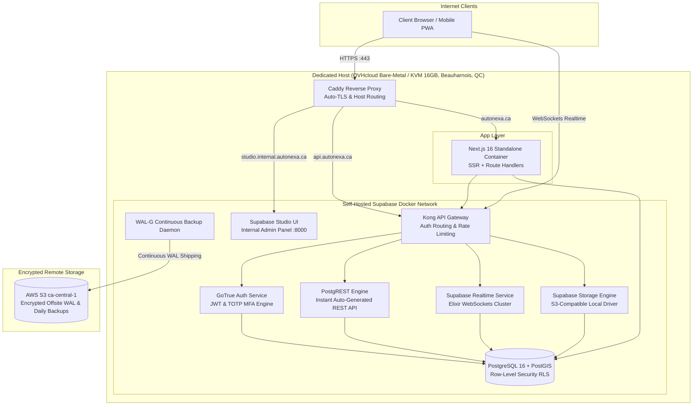

# Scenario 4b — Fully Self-Hosted Supabase + Next.js on Dedicated VPS / Hardware

> **Self-Sovereign Open Source Stack:** Complete Supabase Docker Stack (Postgres 16, PostGIS, GoTrue, PostgREST, Realtime, Storage, Kong) + Next.js 16 Container · Hosted on OVHcloud Canada Bare Metal or Dedicated VPS
> Managed Supabase alternative: [03-nextjs-supabase-vercel.md](./03-nextjs-supabase-vercel.md) · Raw VPS: [02-custom-backend-self-hosted-vps.md](./02-custom-backend-self-hosted-vps.md)

---

## 1. Summary & when to choose

Supabase is completely open source. Under this scenario, the entire Supabase infrastructure—including PostgreSQL 16, PostGIS, the Kong API gateway, GoTrue Auth engine, PostgREST, Realtime WebSocket server, and Supabase Storage—is self-hosted using the official Supabase Docker Compose stack alongside a Next.js standalone container on a high-spec Canadian VPS or bare-metal server (e.g. OVHcloud Beauharnois, Quebec).

**Choose when:**
- The client wants **all the developer productivity benefits of Supabase** (PostgREST, Realtime WebSockets, GoTrue Auth with MFA, and RLS) but **strictly refuses to pay monthly SaaS subscription tiers to Supabase Cloud or Vercel**.
- The client mandates complete on-premise or sovereign bare-metal hardware control for regulatory, legal, or political reasons.
- You want zero usage limits, zero API rate caps, and a completely fixed hosting cost ($75–$150 CAD/month flat).

**Avoid when:**
- The engineering team does not have strong Docker Compose, Linux server management, and PostgreSQL DBA skills.
- The team wants turnkey automated point-in-time database recovery without configuring and monitoring backup daemons.

---

## 2. Architecture

---

## 3. Tech stack & components

| Component | Self-Hosted Open-Source Technology | Notes |
|---|---|---|
| **Host Machine** | **OVHcloud Advance Bare-Metal or High-RAM VPS** | 8 vCPU, 32 GB RAM, 2x 512GB NVMe RAID1 in Beauharnois, Quebec (~$90–$140 CAD/mo). |
| **Reverse Proxy** | **Caddy v2** | Manages wildcard TLS certificates, proxies to Kong and Next.js. |
| **Database** | **Official `supabase/postgres:15.6.x` / 16** | Pre-configured with PostGIS, `pg_cron`, `pg_stat_statements`, and WAL replication. |
| **Auth** | **GoTrue (`supabase/gotrue`)** | Standalone Go microservice providing signup, login, password recovery, and TOTP MFA. |
| **Data API** | **PostgREST (`postgrest/postgrest`)** | Ultra-fast Haskell binary exposing PostgreSQL tables and RPC functions as RESTful JSON endpoints. |
| **Realtime** | **Realtime (`supabase/realtime`)** | Elixir/Phoenix WebSocket service listening to Postgres WAL publication to broadcast updates. |
| **File Storage** | **Supabase Storage (`supabase/storage-api`)** | Can use local NVMe disk backed up to S3, or proxy directly to AWS S3 `ca-central-1`. |
| **Database Studio** | **Supabase Studio (`supabase/studio`)** | Browser-based table editor, SQL runner, and role manager protected behind VPN or HTTP Basic Auth. |
| **Backup Daemon** | **WAL-G to AWS S3 `ca-central-1`** | Ships Postgres WAL segments continuously every 16MB or 5 minutes to meet NFR-10 (RPO < 1h). |

---

## 4. NFR matrix evaluation

| NFR | Requirement | Status | How It Is Handled in Self-Hosted Supabase |
|---|---|:---:|---|
| **NFR-01** | Page load < 2s; API < 500ms | **✅** | Extreme speed: Next.js and Kong/Postgres run on the same physical host over Unix sockets / Docker bridge (< 1ms internal latency). |
| **NFR-02** | **Bid submission < 200ms** | **✅** | PostgREST RPC call executes in ~10–20ms. |
| **NFR-03** | 5,000 users, 1,000 auctions | **✅** | A 32GB RAM bare-metal server easily handles 10,000 concurrent Realtime WebSocket connections. |
| **NFR-04** | 99.9% availability | **⚠️** | Single physical machine risk. Requires an automated offsite backup and a documented disaster recovery script. |
| **NFR-05** | Encryption (AES-256) | **✅** | LUKS encrypted disk on host; TLS 1.3 on Caddy. |
| **NFR-06** | **MFA (TOTP) for Admins** | **✅** | GoTrue auth service natively supports TOTP MFA without external dependencies. |
| **NFR-07** | Rate limiting & OWASP | **✅** | Kong API Gateway has built-in rate-limiting plugins; Caddy provides edge IP throttling. |
| **NFR-08** | Privacy (Law 25 & PIPEDA) | **✅** | 100% physically located inside Quebec, Canada (OVHcloud BHS datacenter). |
| **NFR-09** | Canadian data residency | **✅** | Server and backup S3 bucket are both physically on Canadian soil. |
| **NFR-10** | **RPO 1h, RTO 4h** | **✅** | WAL-G continuous streaming to S3 provides RPO < 10 minutes. RTO depends on spin-up script (~1–2 hours). |
| **NFR-15** | Idempotency & Locking | **✅** | Postgres `SELECT ... FOR UPDATE` inside atomic stored procedure functions. |
| **NFR-16** | 70% Unit test coverage | **✅** | Testable against a local Dockerized Supabase instance in GitHub Actions CI. |

---

## 5. Cost bands (Estimates in CAD/month)

| Component | MVP Stage | Production High-Availability |
|---|---|---|
| Dedicated Host (OVH Bare-Metal 8-core, 32GB RAM) | ~$110 CAD | ~$110 CAD (Primary) + ~$65 CAD (Standby VPS) |
| Remote Backup S3 `ca-central-1` (Encrypted WALs) | ~$15 CAD | ~$30 CAD |
| Caddy Reverse Proxy & Domain DNS | ~$5 CAD | ~$10 CAD |
| Third-party SaaS (SendGrid, Twilio, Stripe) | Usage-based | Usage-based |
| **Total Hosting Cost** | **~$130 CAD / month flat** | **~$215 CAD / month flat** |

*Key Advantage:* **Zero per-user, per-seat, or per-document fees.** Whether you have 100 users or 50,000 users, your hosting bill remains fixed.

---

## 6. Effort & operational burden

| Workstream | Estimate (2 Engineers with Linux/DevOps experience) |
|---|---|
| Linux server hardening, Docker Compose Supabase stack tuning, Kong configuration | 2.0 weeks |
| WAL-G automated offsite backup pipeline & disaster recovery runbook | 1.0 week |
| Database schema migrations, RLS security rules, PostGIS & MFA setup | 1.5 weeks |
| Next.js standalone container deployment & S3 storage integration | 1.5 weeks |
| Auction bidding engine (RPC functions) & Realtime WebSocket testing | 2.0 weeks |
| Admin panels, dispute workflows, 7-year audit logs exporter | 1.5 weeks |
| **Total Time-to-Production** | **~9–10 weeks** |

---

## 7. Risks & mitigation

| Risk | Impact | Mitigation Strategy |
|---|---|---|
| **Operational Maintenance (DB upgrades)** | High | Supabase releases frequent updates to GoTrue and Realtime. Pin all Docker image tags to exact versions; never use `:latest`. |
| **Server Hardware Failure** | High | Automated continuous WAL shipping to AWS S3; automated restore script tested bi-weekly in CI. |
| **Kong Configuration Complexity** | Medium | Use the official Supabase `docker-compose.yml` template without modifying core proxy routes. |

---

## 8. Impact on current Next.js frontend

- **100% Code Compatibility:** The frontend interacts with the self-hosted Supabase instance using the standard `@supabase/ssr` library. The only difference is `NEXT_PUBLIC_SUPABASE_URL=https://api.autonexa.ca`.
- If the team ever decides to migrate from Self-Hosted Supabase to Supabase Cloud (or vice versa), **zero frontend code needs to be modified**—only the URL and API keys in the `.env` file change!
