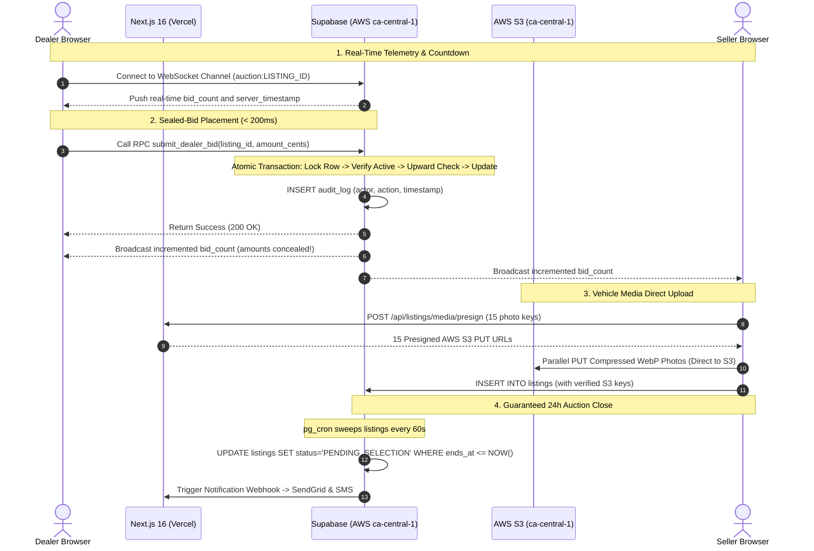

# AutoNexa / CAMP — Master Backend Architecture Recommendation & Decision Matrix

> **Authoritative Decision Document** · Prepared: 2026-10-19  
> **Inputs Analyzed:** SRS v1.0 (Nexar Sol), Canadian Regulations (PIPEDA, Law 25, OMVIC/AMVIC/VSA), `context/*.md`, Next.js 16 App Router Codebase

---

## 1. Executive Summary

The backend engineering team posed three critical questions regarding the architecture and tech stack for the **AutoNexa / CAMP (Canadian Auto Marketplace Platform)**:

1. **Which tech stack and architecture best fit this platform**, given its requirements, expected workload, and the level of professionalism expected?
2. **Can the backend be built directly in Next.js?** If so, what is the exact tech stack and operational architecture?
3. **If we move ahead with a BaaS, can we use Supabase or Firebase to complete this fast, and which should we choose?**

After rigorous analysis across 8 detailed architectural scenarios, evaluating real-world Canadian regulatory requirements, database transactions, sealed-bid secrecy, real-time telemetry, and operational costs, here are the direct answers:

---

## 2. Direct Answers to the 3 Team Questions

### Q1: What is the most suitable architecture and tech stack?
- **Recommended Primary Architecture:** **Next.js 16 on Vercel + Managed Supabase Cloud (deployed in AWS Montreal `ca-central-1`)** (*[Scenario 3](./03-nextjs-supabase-vercel.md)*).
- **Why:** AutoNexa is a strongly relational domain with geo-radius searches (PostGIS), sealed-bid secrecy (PostgreSQL RLS & security-definer views), and real-time bid counters (WebSocket broadcast). Supabase Cloud in AWS Montreal satisfies 100% of Canadian data residency mandates (PIPEDA & Quebec Law 25) with zero ops overhead, 5-minute Point-in-Time Recovery (PITR), native TOTP MFA for admins, and delivers an MVP in **7–8 weeks** with a 2-person team.
- **Enterprise Sovereign Fallback:** If institutional investors or dealership groups mandate a single enterprise cloud provider with zero third-party BaaS dependencies, use **All-in AWS `ca-central-1` (ECS Fargate + RDS PostgreSQL Multi-AZ)** (*[Scenario 2b](./02b-custom-backend-aws-full.md)*).
- **Strict Budget Fallback:** If the client insists on a flat $80 CAD/month fixed server bill, use **Docker Compose on an OVHcloud Beauharnois, Quebec VPS** (*[Scenario 2](./02-custom-backend-self-hosted-vps.md)*).

---

### Q2: Can the backend be built in Next.js? What is its stack?
- **Answer:** **YES, absolutely.** Next.js 16 App Router can serve as the entire backend without writing a separate NestJS or Express server (*[Scenario 3c](./03c-nextjs-fullstack-own-db-vercel.md)*).
- **The Complete Next.js Serverless Tech Stack:**
  - **Framework / API Layer:** Next.js 16 App Router Route Handlers (`app/api/**/route.ts`) validating inputs via Zod.
  - **ORM / Query Builder:** **Drizzle ORM** (ultra-lightweight < 5ms startup, raw SQL control for transactions and PostGIS).
  - **Database:** **Managed PostgreSQL 16 + PostGIS** (in AWS `ca-central-1` Montreal via Neon Serverless Postgres or AWS RDS).
  - **Connection Pooler (Crucial):** **PgBouncer / Neon Connection Pooler** to prevent serverless lambdas from exhausting Postgres connection limits.
  - **Durable 24h Timers (H3):** **Upstash QStash** to schedule signed HTTP webhooks at `auction_ends_at` (because serverless lambdas cannot run BullMQ worker loops).
  - **1-Minute Reconciliation Sweep:** **Vercel Cron (`vercel.json`)** calling `/api/cron/reconcile-auctions`.
  - **Realtime Telemetry (H5):** **Ably** or **Upstash Redis SSE** for fan-out to 5,000+ dealers (serverless functions cannot hold multi-hour open WebSockets).
  - **Authentication:** Custom JWT in HttpOnly cookies + `otplib` for mandatory admin TOTP MFA.
  - **Media Storage:** AWS S3 `ca-central-1` with direct presigned PUT URLs.

---

### Q3: Supabase vs Firebase — Can we use either, and which to choose?
- **Answer:** **Choose Supabase. Reject Firebase.**
- **Detailed Evaluation:**

| Capability | Supabase (Recommended ✅) | Firebase (Strongly Discouraged ❌) |
|---|---|---|
| **Data Model & Joins** | **Relational PostgreSQL 16**. Single queries join listings, vehicles, photos, distance, and bids effortlessly. | **NoSQL Document Store (Firestore)**. No joins. Massive data duplication and synchronization bugs across collections. |
| **Sealed-Bid Secrecy (H1)** | **Native Row-Level Security (RLS)** & database views. Hides bid amounts while exposing bid counts in the engine. | **Document-Level Security Rules**. Cannot hide individual document fields; requires awkward sub-collections and Cloud Function bridges. |
| **Upward-Only Bids (H2)** | **Postgres `SELECT ... FOR UPDATE`**. Instant row locks eliminate race conditions in < 30ms. | **Firestore `runTransaction`**. Suffers from contention aborts under heavy final-minute bidding spikes (1 write/sec limit per doc). |
| **Dealer Geo-Radius (H6)** | **Native PostGIS (`ST_DWithin`)** with spatial GiST indexing. Native, fast, accurate. | **No PostGIS**. Requires clumsy Geohashes, bounding-box approximations, and client-side Euclidean filtering. |
| **Canadian Residency** | **AWS Montreal (`ca-central-1`)** is an official Supabase Cloud deployment region. | Fragmented: Firestore can be in Montreal, but **Firebase Auth is globally distributed**, risking Law 25 compliance. |
| **Realtime Telemetry (H5)** | **Included in compute plan**. Millions of broadcast messages without per-message charges. | **Charges per document read**. 5,000 concurrent dealers watching live inventory can generate millions of billable reads/day. |
| **MFA TOTP (NFR-06)** | **Built-in natively** (`supabase.auth.mfa`). Zero custom code needed. | Requires Google Cloud Identity Platform enterprise upgrade with separate SMS/MFA pricing. |
| **Backup & DR (NFR-10)** | **Point-in-Time Recovery (PITR)** with continuous WAL archiving (5-minute RPO). | Scheduled daily/hourly exports only. Lacks continuous PITR. |
| **Exit Strategy / Portability** | **100% standard PostgreSQL**. Dump via `pg_dump` and run on any VPS or AWS RDS in 1 hour. | **Extreme vendor lock-in**. Proprietary NoSQL schemas, Security Rules, and Cloud Functions require complete rewrite. |

---

## 3. Master Decision Matrix: All Scenarios Compared

Every scenario is graded on a **1 to 5 scale** (5 = Outstanding, 1 = Poor/Incompatible) across the 10 weighted criteria defined in `README.md`:

| Criterion | Weight | 1A: NestJS + Vercel | 1B: NestJS + AWS | 2: Raw VPS (SRS) | 2B: Full AWS (Enterprise) | 3: Next.js + Supabase | 3B: Next.js + Firebase | 3C: Next.js Fullstack Own DB | 4: Next.js Off-Vercel + Supabase | 4B: Self-Hosted Supabase |
|---|:---:|:---:|:---:|:---:|:---:|:---:|:---:|:---:|:---:|:---:|
| **1. Domain Fit (ACID, PostGIS)** | 15% | 5 | 5 | 5 | 5 | **5** | 1 | 5 | 5 | 5 |
| **2. Durable Timers & Jobs** | 12% | 5 | 5 | 4 | 5 | **4.5** | 2 | 4 | 4.5 | 4 |
| **3. Realtime Telemetry (~5k)** | 10% | 4 | 4.5 | 3.5 | 4.5 | **5** | 3 | 4 | 5 | 4.5 |
| **4. NFRs (99.9%, RPO 1h, MFA)** | 13% | 4 | 5 | 3 | 5 | **4.5** | 2.5 | 4 | 4 | 3.5 |
| **5. Canadian Residency** | 10% | 3.5 | 5 | 5 | 5 | **5** | 2.5 | 5 | 5 | 5 |
| **6. Time-to-MVP** | 12% | 3 | 2.5 | 3 | 2 | **5** | 4 | 3.5 | 4.5 | 3.5 |
| **7. Cost Efficiency (MVP)** | 8% | 3.5 | 2.5 | 5 | 2 | **4** | 3 | 4.5 | 4.5 | 4.5 |
| **8. Low Ops Burden** | 8% | 4 | 2 | 2 | 1.5 | **5** | 3.5 | 3.5 | 3.5 | 2 |
| **9. Portability & Low Lock-in** | 6% | 5 | 4.5 | 5 | 4 | **4.5** | 1 | 4.5 | 4.5 | 5 |
| **10. Team Fit (Next.js/TS)** | 6% | 3.5 | 3.5 | 3.5 | 3.5 | **5** | 3.5 | 5 | 4.5 | 4.5 |
| **WEIGHTED SCORE (out of 5.0)** | **100%** | **4.13** | **4.08** | **3.88** | **3.94** | **4.64** | **2.43** | **4.27** | **4.49** | **4.12** |

### Matrix Scoring Highlights:
1. **Scenario 3 (Next.js + Supabase on Vercel) scores #1 (4.64 / 5.00)** — Maximum development velocity, native relational/PostGIS domain fit, turnkey Canadian data residency, built-in MFA, and minimal operations burden.
2. **Scenario 4 (Next.js Container + Supabase Cloud) scores #2 (4.49 / 5.00)** — The best option if the client wants Supabase's features but refuses to pay Vercel's recurring hosting tiers.
3. **Scenario 3C (Next.js Fullstack with Drizzle + QStash) scores #3 (4.27 / 5.00)** — The cleanest pure Next.js serverless option without a BaaS.
4. **Scenario 3B (Firebase) scores last (2.43 / 5.00)** — Fundamental failure on relational queries, PostGIS spatial queries, and sealed-bid privacy.

---

## 4. "Choose X If..." Situational Decision Guide

Use this guide in your client/stakeholder review meeting:

```
                                  [Decision Point]
                                         │
        ┌────────────────────────────────┴────────────────────────────────┐
        ▼                                                                 ▼
[Client wants MVP in 6–8 weeks;                               [Client forbids all BaaS /
 prefers high velocity & low ops]                             requires 100% owned servers]
        │                                                                 │
        ▼                                                                 ▼
[Do they want Vercel?]                                        [What is their infrastructure budget?]
  ├── YES ──► Choose SCENARIO 3 (Next.js + Supabase on Vercel)   ├── $80 CAD/mo flat ──► Choose SCENARIO 2 (OVH VPS Docker)
  └── NO  ──► Choose SCENARIO 4 (Next.js VPS + Supabase Cloud)  └── $500+/mo cloud  ──► Choose SCENARIO 2B (Full AWS ca-central-1)
```

- **Choose Scenario 3 (Next.js + Supabase on Vercel) if:**
  You want to demo a working, production-grade automotive marketplace in 7 weeks. You have a lean team and want auth, MFA, real-time WebSockets, and spatial queries working on Day 1 without spinning up Docker daemon clusters.

- **Choose Scenario 2 (Self-Hosted VPS on OVHcloud Canada) if:**
  The client has a hard financial ceiling of $100 CAD/month, already owns a Hostinger or OVH Linux server, and insists on a self-contained monolith.

- **Choose Scenario 2b (All-in AWS `ca-central-1`) if:**
  The project is funded by enterprise dealership networks or banks that demand SOC 2 compliance, AWS Multi-AZ failover, AWS WAF, and a single legal DPA with Amazon Web Services Canada.

- **Choose Scenario 3c (Next.js Fullstack with Drizzle + QStash) if:**
  You want a single unified Next.js codebase without Supabase RLS, maintaining full control over SQL migrations and using modern serverless primitives.

---

## 5. Detailed Architecture Blueprint: Recommended Stack (Scenario 3)

### System Data Flow


---

## 6. Financial Comparison: MVP vs Growth

| Scenario | MVP Monthly Cost | Scaled Monthly Cost (5,000 Dealers) | Primary Cost Driver |
|---|---|---|---|
| **Scenario 1A: NestJS + Vercel** | ~$160 USD | ~$650 USD | Container PaaS + Managed Redis + Vercel |
| **Scenario 1B: NestJS + AWS** | ~$380 USD | ~$1,200 USD | Multi-AZ RDS + ECS Fargate + ALB |
| **Scenario 2: Self-Hosted VPS** | **~$80 CAD** | **~$175 CAD** | Flat VPS hardware (Lowest financial cost) |
| **Scenario 2B: Full AWS Enterprise**| ~$430 USD | ~$1,185 USD | Enterprise AWS services & Multi-AZ |
| **Scenario 3: Next.js + Supabase** | **~$160 USD** | **~$380 USD** | Supabase Pro + PITR + Vercel Pro |
| **Scenario 3B: Next.js + Firebase** | ~$70 USD | **~$950+ USD** | High-frequency document read spikes |
| **Scenario 3C: Next.js + Own DB** | ~$60 USD | ~$450 USD | Neon Serverless + Ably Realtime |
| **Scenario 4: Next.js VPS + Supabase**| ~$180 CAD | ~$380 CAD | Flat App VPS + Supabase Pro |
| **Scenario 4B: Self-Hosted Supabase** | ~$130 CAD | ~$215 CAD | Dedicated Bare-Metal server flat fee |

---

## 7. Migration Safety Net: What if We Need to Switch Later?

A critical requirement for engineering leadership is **avoiding dead ends**.

Because the primary recommendation (**Scenario 3: Supabase**) is built on standard, open-source **PostgreSQL 16**, the team is **never locked in**:
1. **Zero Schema Lock-In:** All tables, foreign keys, GIS columns, and indexes are standard PostgreSQL. A standard `pg_dump` can export the entire database in 2 minutes.
2. **Portability to Self-Hosted:** If Supabase Cloud ever becomes too expensive, you can deploy the database to an OVH Canada VPS (*Scenario 4b*) or an AWS RDS instance (*Scenario 1b*) with zero schema modifications.
3. **Frontend Isolation:** The frontend data layer uses TanStack Query v5 hooks. Migrating from Supabase SDK to standard REST endpoints requires changing only the internal fetcher functions inside `lib/api-client.ts`, with **zero modifications to React components or page layouts**.

---

## 8. Immediate Action Plan

To proceed with building the AutoNexa platform:

1. **Team Alignment:** Share this `MASTER-RECOMMENDATION.md` and review with the project stakeholders and backend leads.
2. **Database Provisioning (Day 1):** Create the Supabase project in region **`AWS Canada (Central) ca-central-1`** and enable the `postgis` and `pg_cron` extensions.
3. **Environment Setup:** Configure `NEXT_PUBLIC_SUPABASE_URL` and `NEXT_PUBLIC_SUPABASE_ANON_KEY` in `.env.local`.
4. **Deploy Schema Migrations:** Run the initial DDL migrations for `users`, `dealerships`, `listings`, and `bids` with the sealed-bid RLS policies defined in `03-nextjs-supabase-vercel.md`.
5. **Resume Frontend Milestones:** Proceed with **Phase 4.1 (Seller Dashboard)** and **Phase 4.2 (Listing Wizard)** in `context/progress-tracker.md`, connecting forms directly to live PostgreSQL mutations!
